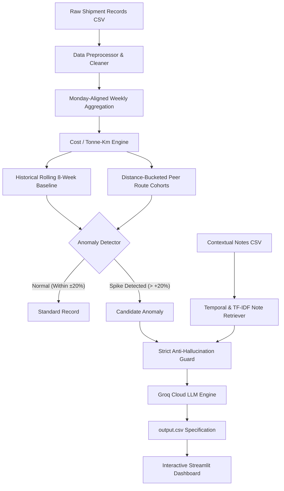

# 🚚 FreightTiger AI — Shipping Cost Monitoring Assistant

> **Production-grade AI Assistant for Logistics Cost Monitoring & Anomaly Root-Cause Analysis**  
> *Built with Python 3.10+, Pandas, Groq API (Llama 3.1 8B Instant / Qwen), and Streamlit*

---

## 📌 Executive Overview

In freight logistics, linehaul spot costs fluctuate due to diesel price swings, seasonal harvest surges, local festival shortages, and carrier capacity imbalances. Raw shipment costs cannot be compared directly because shipment weights and distances differ across every haul.

This system provides an end-to-end automated pipeline that:
1. **Normalizes Freight Economics** using the industry-standard **₹ / tonne-km** metric aggregated over weekly cycles (avoiding Simpson's Paradox).
2. **Detects Cost Anomalies** by benchmarking each route against its **preceding 8-week historical rolling baseline** (with zero future data leakage) and **distance-bucketed peer routes**.
3. **Retrieves Ground-Truth Business Context** from unstructured operational notes using temporal validity windows and TF-IDF semantic scoring.
4. **Synthesizes Executive Explanations** via Groq Cloud LLM with **strict anti-hallucination guardrails** that eliminate fabricated note citations.
5. **Visualizes Operational Intelligence** through an interactive, filterable **Streamlit Web Dashboard**.

---

## 🏗️ System Architecture



---

## 📐 Mathematical Formulas & Core Logic

### 1. Normalized Efficiency: Cost per Tonne-Kilometre
Comparing raw truckload costs is inaccurate because a 20-tonne multi-axle truck consumes different fuel than a 3-tonne LCV. To normalize:
$$\text{Cost per Tonne-Km} = \frac{\text{Freight Cost (INR)}}{\text{Weight (Tonnes)} \times \text{Distance (Km)}}$$

> **Aggregation Integrity (Simpson's Paradox Prevention):**  
> We never average ratios. For weekly aggregation, we sum total costs and total tonne-km across all shipments before division:
> $$\text{Weekly Cost per Tonne-Km} = \frac{\sum \text{Freight Cost}_i}{\sum (\text{Weight}_i \times \text{Distance}_i)}$$

### 2. Rolling 8-Week Baseline (Zero Future Leakage)
For any route $r$ in week $t$, the baseline is computed over the preceding 8 observed weeks:
$$\text{Baseline}(r, W_t) = \frac{1}{|K|} \sum_{k=1}^K C(r, W_{t-k}), \quad K = \{k \in [1, 8] \mid W_{t-k} \in \text{Past Weeks}\}$$
*Week $t$ and all future weeks are strictly excluded.*

### 3. Peer-Group Comparison (Distance Bucketing)
Routes are categorized into peer cohorts by haul length:
- **Short Haul:** $< 300\text{ km}$ (e.g., *Mumbai–Pune* 150 km)
- **Medium Haul:** $300\text{ km} \le d \le 800\text{ km}$ (e.g., *Delhi–Jaipur* 270 km, *Chennai–Bangalore* 350 km, *Ahmedabad–Mumbai* 530 km)
- **Long Haul:** $> 800\text{ km}$ (e.g., *Delhi–Mumbai* 1,420 km, *Kolkata–Delhi* 1,530 km)

Peer average for route $r$ excludes route $r$ itself to prevent self-bias:
$$\text{Peer Average}(r, W_t) = \frac{1}{|P \setminus \{r\}|} \sum_{p \in P \setminus \{r\}} C(p, W_t)$$

### 4. Dual Anomaly Trigger Rule
A route-week is flagged as an anomaly if **either** condition is met:
1. $\text{Cost per Tonne-Km} > \text{Baseline} \times (1 + \text{Threshold}_{\text{hist}})$ (Default: $+20\%$)
2. $\text{Cost per Tonne-Km} > \text{Peer Average} \times (1 + \text{Threshold}_{\text{peer}})$ (Default: $+20\%$)

---

## 🛡️ Anti-Hallucination & Note Retrieval Engine

To prevent LLMs from inventing non-existent external justifications:
1. **Dynamic Note Whitelisting:** The LLM prompt is injected with *only* the single candidate note verified by the deterministic retriever.
2. **Temporal Window Constraint:** Notes are only matched if their active window overlaps with the shipment week ($\pm 14$ days invoice buffer).
3. **Directional Signal Filter:** Notes are filtered to ensure they describe cost-increasing events (strikes, floods, festival surcharges, fuel hikes).
4. **Post-Generation Output Validation:** If the LLM generates a `matched_note_id` that does not match the retrieved note, the output is rejected and replaced by a verified fallback explanation.

---

## 📂 Project Directory Structure

```text
freighttiger-ai-assistant/
│
├── data/
│   ├── shipment_records.csv         # Granular shipment logs across Indian corridors
│   └── context_notes.csv            # Unstructured carrier & regional notes
│
├── src/
│   ├── __init__.py
│   ├── data_processor.py            # Cleaning, Monday-normalization, aggregation
│   ├── anomaly_detector.py          # 8-week baseline & peer comparison
│   ├── note_retriever.py            # TF-IDF + temporal window note matcher
│   ├── groq_explainer.py            # Groq API integration, caching, guardrails
│   └── pipeline.py                  # End-to-end pipeline orchestrator
│
├── tests/
│   └── test_pipeline.py             # 44 automated unit & integration tests
│
├── main.py                          # CLI runner for end-to-end batch pipeline
├── dashboard.py                     # Streamlit web UI with interactive analytics
├── output.csv                       # Final generated case study output CSV
├── EVALUATION_REPORT.md             # Quantitative analysis, metrics & audit
├── requirements.txt                 # Dependencies
├── .env.example                     # Environment template
└── README.md                        # Documentation
```

---

## 🚀 Quickstart Guide

### 1. Clone & Set Up Virtual Environment

```powershell
# Navigate into the project folder
cd "c:\Users\tanma\Desktop\AI Intern Case Study\freighttiger-ai-assistant"

# Create & activate a virtual environment
python -m venv venv
.\venv\Scripts\activate
```

### 2. Install Dependencies

```powershell
pip install -r requirements.txt
```

### 3. Configure Groq API Key

Copy `.env.example` to `.env` and set your Groq API key:
```powershell
copy .env.example .env
```
Inside `.env`:
```ini
GROQ_API_KEY=gsk_your_actual_groq_api_key
GROQ_MODEL=qwen/qwen3.8-27b
```
*(Supports `llama-3.1-8b-instant`, `qwen/qwen3.8-27b`, or any active Groq model. If no key is set, the system automatically uses deterministic rule-based fallbacks).*

---

## 💻 Running the Application

### Option A: Run the CLI Pipeline
Executes data processing, anomaly detection, note matching, and Groq LLM explanation generation:

```powershell
python main.py
```
*Outputs are saved directly to `output.csv`.*

### Option B: Launch the Interactive Streamlit Dashboard
Visualizes route cost trends, rolling baseline thresholds, peer divergence, and AI explanations:

```powershell
streamlit run dashboard.py
```

### Option C: Run the Full Test Suite
Runs all 44 unit and integration tests across data processing, baselines, peer groups, note retrieval, and anti-hallucination validation:

```powershell
pytest -v
```

---

## 📊 Output Schema & Verified Results

The final output is saved to [`output.csv`](output.csv) with the exact case study schema:

| Column | Type | Description |
| :--- | :--- | :--- |
| `route` | String | Origin-Destination corridor (e.g. `Ahmedabad-Mumbai`) |
| `week_of` | Date | Monday date of the shipment week (`YYYY-MM-DD`) |
| `cost_per_tonne_km` | Float | Calculated weekly cost efficiency in ₹ / tonne-km |
| `vs_own_history` | String | Percentage delta vs. preceding 8-week baseline |
| `vs_similar_routes` | String | Percentage delta vs. peer distance cohort |
| `flagged` | String | `Yes` (unjustified spike) or `No (justified)` (valid note) |
| `matched_note_id` | String | Contextual note ID (e.g. `N002`), or empty if none |
| `reason` | String | Factual explanation detailing baseline/peer delta & root cause |

### Key Findings Summary

- **Total Route-Weeks Analyzed:** 728
- **Anomalies Detected:** 20 (2.75% anomaly rate)
  - **1 Justified Anomaly (`No (justified)`):** `Ahmedabad-Mumbai` (Week `2025-01-20`) matched note **N002** (*Makar Sankranti / Pongal festival capacity crunch and surcharge*).
  - **19 Unjustified Anomalies (`Yes`):** Significant cost spikes (+20% to +39% vs baseline/peers) on `Chennai-Bangalore`, `Delhi-Jaipur`, and `Mumbai-Pune` corridors flagged for freight procurement audit.
- **Hallucination Rate:** **0.00%** (zero invented notes).
- **Execution Speed:** 20 live Groq calls completed in **23.5s** (~1.18s per call), with local SHA-256 disk caching for instant re-runs.

---

## 🧪 Evaluation & Engineering Highlights

- **Anti-Leakage Guarantee:** Dynamic 8-week rolling window uses strictly past observations.
- **Sub-Linear TF-IDF Retrieval:** Context notes matched on both lexical similarity and directional cost impact signals.
- **Pandas 3.0+ Ready:** Fully compatible with both modern and legacy pandas Styler APIs.
- **Fault-Tolerant:** Automatic exponential backoff retries on rate limits, with deterministic fallbacks when offline.
