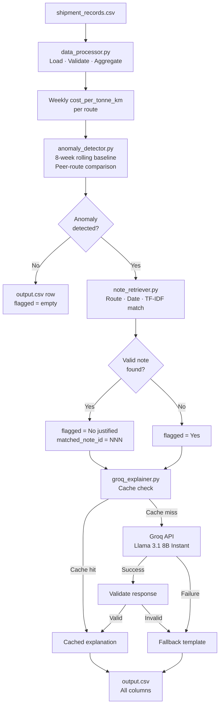

# FreightTiger AI — Shipping Cost Monitoring Assistant

> **FreightTiger AI Intern Case Study** | Python · Pandas · Groq API (Llama 3.1 8B Instant)

A production-quality, lightweight AI assistant that monitors freight transportation costs across Indian logistics routes, detects cost anomalies using deterministic statistical analysis, and generates concise business-ready explanations using the Groq LLM API — with full fallback support when the API is unavailable.

---

## Business Problem

Freight logistics companies manage dozens of routes and thousands of shipments per week. Unusual cost spikes — caused by floods, fuel surcharges, festival demand, or undetected billing errors — can erode margins if not caught early. Manual review of weekly cost reports is slow and error-prone.

This assistant automates the detection of statistically significant cost anomalies, retrieves relevant contextual notes (e.g. "flooding on Chennai-Bangalore highway"), and generates clear, fact-grounded explanations that a logistics manager can act on immediately.

---

## Architecture



---

## Data Processing Strategy

### Formula

```
cost_per_tonne_km = sum(freight_cost_inr) / sum(quantity_tonnes × distance_km)
```

Aggregation uses **sum-based** cost calculation (not row-mean) so that larger shipments receive appropriate weight within each weekly group.

### Weekly Grouping

Shipments are assigned to **Monday-anchored ISO weeks** (`pd.Period("W-SUN").start_time`), ensuring a consistent 7-day window regardless of month boundaries.

### Routes Covered

| Route | Type | Period |
|---|---|---|
| Mumbai-Pune | Short | Jan 2024 – Dec 2025 |
| Delhi-Jaipur | Short | Jan 2024 – Dec 2025 |
| Chennai-Bangalore | Medium | Jan 2024 – Dec 2025 |
| Kolkata-Bhubaneswar | Medium | Jan 2024 – Dec 2025 |
| Ahmedabad-Mumbai | Medium | Jan 2024 – Dec 2025 |
| Mumbai-Delhi | Long | Jan 2024 – Dec 2025 |
| Delhi-Chennai | Long | Jan 2024 – Dec 2025 |

---

## Anomaly Detection Approach

Two independent signals are computed for every (route, week_of) combination:

### Signal 1 — Own Historical Baseline

```
baseline = mean(cost_per_tonne_km for previous 8 available weeks)
vs_own_history = (current_cost - baseline) / baseline × 100
```

- **Strictly excludes the current week** (no future-data leakage)
- Uses up to 8 previous weeks; handles incomplete history gracefully
- Rows with zero prior weeks have `NaN` baseline and are not flagged via this signal

### Signal 2 — Peer Route Comparison

```
peer_baseline = mean(cost_per_tonne_km of same-type routes, EXCLUDING current route, same week)
vs_similar_routes = (current_cost - peer_baseline) / peer_baseline × 100
```

- Only routes of the **same `route_type`** (Short / Medium / Long) are peers
- Self-exclusion prevents circular comparison

### Flagging Rule

A route-week is flagged **anomalous** if either signal exceeds **+20%**:

```python
anomaly_flag = (vs_own_history >= 20.0) OR (vs_similar_routes >= 20.0)
```

This threshold is consistent with the PDF requirements and can be tuned via constants in `anomaly_detector.py`.

---

## Contextual Note Retrieval Methodology

Notes are retrieved through a 4-stage pipeline (no FAISS, no vector databases):

1. **Route scope filter** — `applies_to` must equal the route name or `"All Routes"`
2. **Date window filter** — note date must be within ±35 days of `week_of`
3. **Cost-increase validation** — notes containing "no significant disruption", "remained normal", or similar phrases are **rejected** — they cannot justify a cost spike
4. **TF-IDF similarity scoring** — among surviving candidates, the note with the highest cosine similarity to the route name query wins; exact-route matches receive a 2× boost

This multi-stage approach ensures only contextually appropriate, temporally relevant, and causally meaningful notes are matched to anomalies.

---

## Why Groq Was Selected

| Criterion | Groq | Alternative |
|---|---|---|
| Speed | Ultra-low latency (tokens/s >> OpenAI) | GPT-4 is slower |
| Cost | $0.05/M prompt tokens (8B model) | GPT-4: $10+/M |
| GPU requirement | None (cloud API) | Local LLMs need VRAM |
| SDK quality | Official Python SDK | — |
| Model | Llama 3.1 8B Instant (OSS, auditable) | Proprietary |

---

## Why Deterministic Decisions Are Safer Than LLM Decisions

LLMs are non-deterministic probability machines. Using them for numeric thresholds, percentage calculations, or anomaly verdicts would produce:

- **Inconsistent results** — the same data produces different verdicts on different runs
- **Hallucinated numbers** — invented percentages that don't match the actual data
- **Silent errors** — no exception is raised when the LLM gives a wrong answer

This project uses Python for **all numeric comparisons and decisions**. Groq is given only pre-validated facts and asked to produce a human-readable narrative — a task where creativity and fluency matter, not precision.

---

## API Cost Optimization

| Technique | Benefit |
|---|---|
| Only call Groq for anomalous rows | 20 calls vs 728 potential calls (97% reduction) |
| SHA-256 cache keyed to all input facts | Zero API calls on repeated runs |
| `max_completion_tokens=280` | Limits response size |
| `temperature=0, seed=42` | Deterministic responses, cache-friendly |
| Exponential backoff (max 3 retries) | Handles transient failures without runaway costs |
| Fallback template on any failure | No crash, no infinite retry |
| Never send raw CSV to Groq | Prompt tokens stay minimal |

---

## How Hallucinations Are Prevented

1. **Pre-validated inputs**: All numeric facts are computed in Python before the prompt is built. Groq cannot change them.
2. **Structured prompt**: The prompt explicitly forbids inventing note IDs, cost values, or dates.
3. **Response validation**: After each Groq response, the code scans for note IDs not in the provided set. Any invented ID causes the response to be discarded and the fallback used.
4. **Verdict lock**: The `flagged` column is set deterministically in Python. Even if Groq says "this looks fine", the Python verdict overwrites it.
5. **Fallback template**: If Groq is unavailable or returns invalid text, a deterministic template produces a factually correct (if brief) explanation.

---

## Installation

### Requirements

- Python 3.10+
- Windows 10/11 (tested), macOS, Linux

### Steps

```powershell
# Clone or extract the project
cd freighttiger-ai-assistant

# Install dependencies
pip install -r requirements.txt

# Configure your Groq API key
copy .env.example .env
# Edit .env and set GROQ_API_KEY=your_key_here
```

---

## Configuration

Edit `.env`:

```env
GROQ_API_KEY=your_groq_api_key_here
GROQ_MODEL=llama-3.1-8b-instant
```

Get a free API key at: https://console.groq.com

---

## Running on Windows

```powershell
# Run the full pipeline (with Groq API)
python main.py

# Run without API (deterministic fallback explanations)
python main.py --no-api

# Verify reproducibility across 3 runs
python main.py --reproduce 3

# Launch the Streamlit dashboard
streamlit run dashboard.py
```

---

## Running the Tests

```powershell
python -m pytest tests/test_pipeline.py -v
```

Expected output: **44 passed** in ~8 seconds.

Test coverage:
- Data parsing & validation (7 tests)
- Weekly cost aggregation (3 tests)  
- 8-week rolling baseline (5 tests)
- Peer-route comparison (2 tests)
- Anomaly detection (5 tests)
- Note retrieval (7 tests)
- Groq explainer / caching / fallback (9 tests)
- Output CSV schema (3 tests)
- Reproducibility (2 tests)

---

## Project Structure

```
freighttiger-ai-assistant/
│
├── data/
│   ├── shipment_records.csv      # 2,940 shipments, Jan 2024 – Dec 2025
│   └── context_notes.csv         # 10 contextual notes
│
├── src/
│   ├── __init__.py
│   ├── data_processor.py         # CSV loading, validation, weekly aggregation
│   ├── anomaly_detector.py       # 8-week baseline + peer comparison + flagging
│   ├── note_retriever.py         # TF-IDF note retrieval with validation
│   ├── groq_explainer.py         # Groq API, caching, fallback
│   └── pipeline.py               # Orchestrator
│
├── tests/
│   └── test_pipeline.py          # 44 pytest tests
│
├── .cache/                       # SHA-256 explanation cache (auto-created)
├── main.py                       # CLI entry point
├── dashboard.py                  # Streamlit dashboard
├── .env                          # API key (never commit)
├── .env.example                  # Template
├── .gitignore
├── requirements.txt
├── output.csv                    # Generated output
├── evaluation_report.md          # Actual measured results
└── README.md
```

---

## Limitations & Future Improvements

| Limitation | Improvement |
|---|---|
| Static 20% threshold | Learn route-specific thresholds from historical variance |
| TF-IDF note retrieval | Use a proper embedding model (e.g. sentence-transformers) |
| No real-time ingestion | Add a Kafka/webhook listener for live shipment events |
| Single-language notes | Add multilingual note support |
| No transporter-level analysis | Break down anomalies by transporter ID |
| No material-type analysis | Track cost variation by material category |
| Dashboard requires manual refresh | Add auto-refresh with scheduled pipeline runs |
# Freighttiger-ai-assistant

